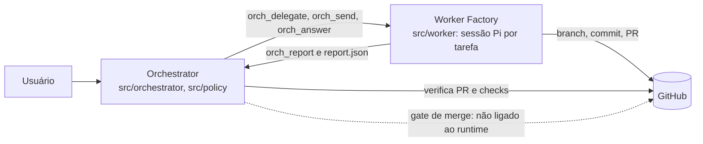

# Pi Factory

Pi Factory coordena sessões Pi independentes em panes do Herdr. Tem dois módulos:

- **Orchestrator**: conversa com você, lança tarefas e planos, acompanha os workers sem usar LLM e avisa só quando há decisão, bloqueio ou conclusão.
- **Worker Factory**: executa cada tarefa numa sessão Pi isolada (worktree do treehouse) até a PR, com revisão e correção antes da integração.

O produto antes se chamava `pi-orchestrator`. O repositório no GitHub continua com esse nome; renomeá-lo é decisão separada, registrada no PR da #149 e não executada.

Não altera `~/.pi/agent`. A extensão é carregada só pelos launchers `bin/pi-factory` (ou o alias `bin/pi-orch`); nada é instalado globalmente.

## Requisitos

- Herdr 0.9.x com a CLI `herdr` no `PATH`.
- Pi (`pi`) instalado; testado com 1.5.2.
- Node.js 22 e npm (para os testes).

Setup reprodutível e checagem de requisitos: ver [SETUP.md](SETUP.md) (`npm run bootstrap`, `npm run doctor`).

## Quickstart

### 1. Checagens (fora do Herdr)

```bash
cd ~/github/pi-orchestrator
npm install        # só devDependencies: tsx, typescript, @types/node, todas com versão fixa
npm test           # testes com Herdr simulado (sem efeitos reais)
node_modules/.bin/tsc -p tsconfig.json   # checagem de tipos
```

### 2. Iniciar a sessão do orquestrador

Dentro de um pane do Herdr:

```bash
~/github/pi-orchestrator/bin/pi-factory
```

O launcher recusa rodar fora do Herdr (`HERDR_ENV=1` e `HERDR_PANE_ID` obrigatórios).

### 3. Pedir a primeira tarefa

Peça em linguagem natural. O orquestrador lança a tarefa com `orch_delegate` (ou registra um plano com `orch_plan_create`). Acompanhe com `orch_status` e `orch_inbox`.

## Launchers

- `bin/pi-factory`: launcher oficial.
- `bin/pi-orch`: alias de compatibilidade. É um `exec` para `bin/pi-factory`, com os mesmos argumentos e o mesmo ambiente. A paridade é testada em `test/launcher-alias.test.ts`.

Os dois mantêm as variáveis `PI_ORCH_*`, o estado em `~/.pi/orchestrator/` e os nomes de tools `orch_*`. Nada disso foi migrado.

## Módulos



- **Orchestrator** (`src/orchestrator/`, regras puras em `src/policy/`): tools `orch_*` usadas por você, watchers, planos, fix loop de PRs com CI vermelho, avisos de conclusão e ciclo de vida das tarefas. Não executa trabalho do projeto.
- **Worker Factory** (`src/worker/`): extensão carregada em cada worker, com `orch_report`, `orch_submit_plan`, `orch_mark_tdd`, bloqueio de `AskUserQuestion` e o adaptador de review fresh (`review.ts`). Contratos e gates compartilhados (ticket de execução, evidência de TDD, política e gate de merge) ficam em `src/shared/`.

## Workflow

O fluxo é `PLAN → IMPLEMENT/TDD → PR → FRESH REVIEW → FIX → MERGE`. Cada etapa tem a situação real de hoje:

1. **PLAN.** O worker registra o plano com `orch_submit_plan` antes de editar; plano sem critério ou diagnóstico verificável é recusado. Você também pode entregar um plano pronto (`orch_plan_create`, em rascunho) e aprová-lo com `orch_plan_approve`. _Implementado e testado._
2. **IMPLEMENT/TDD.** Para cada test seam, o worker roda o teste antes e depois da correção e registra `orch_mark_tdd` como `red` e `green`; o exit code é medido pela ferramenta. _Implementado; o harness do pipeline confere a evidência._
3. **PR.** No modo `direct-pr`, o worker cria a branch, commita, faz push e abre a PR. O `orch_report` `done` precisa trazer a PR em `artifacts`, e o orquestrador confere no GitHub se ela é mergeável e está com checks verdes. _Implementado e testado._
4. **FRESH REVIEW.** Revisão somente leitura do head_sha atual por um subagent de contexto limpo, na mesma credencial do repo (`src/shared/review.ts`). O worker envia o veredito com `orch_review_verdict`, e `checkPr` o aplica ao fix loop e ao merge gate. _Implementado e testado por partes; o loop `checkPr` não foi exercitado com GitHub e worker reais._
5. **FIX.** CI vermelho reabre a correção no mesmo branch (`orch_fix_red_prs` e o fix loop). _Implementado e testado._
6. **MERGE.** Só com a política de auto-merge descrita abaixo. _Gate implementado e testado com fakes; nenhuma tool do runtime o chama, então nenhum merge automático acontece hoje._

O fluxo inteiro é validado pelo harness com GitHub e Herdr simulados (`npm test`, em `test/pipeline.test.ts`; `npm run eval:pipeline` imprime o relatório). O próprio harness lista o que não cobre: GitHub real (latência, falhas de API, regras de proteção), e a ligação do review e do gate ao orquestrador em produção. O smoke com conta real é **NOT RUN**.

## Revisão de escopo

Antes de um item de plano sem PR avançar no `done`, o orquestrador confere o resultado contra a spec e contra a visão do projeto. Itens com PR avançam no merge, como antes, porque o merge continua sendo do usuário.

1. **Visão lida do projeto.** O orquestrador lê `VISION.md` da raiz do projeto, inteiro e sem corte. O conteúdo entra no brief do worker (seção `## Visão do projeto (VISION.md)`) e no contrato da revisão.
2. **Sem `VISION.md`.** O orquestrador avisa uma vez por projeto, sugerindo criar o arquivo com a skill `vision`. O fluxo segue, e a revisão confere só contra a spec.
3. **Verificação e revisão.** Quando o worker reporta `done` e a verificação determinística aprova (ou não se aplica), o LLM do orquestrador roda o subagent `oracle` com contexto limpo, somente leitura, e entrega a spec ou ticket de origem, o pedido, a branch ou artefatos e o `VISION.md`. O revisor responde um JSON `{"verdict": "aligned" | "out_of_scope" | "unverified", "reason": "..."}`, que é gravado com `orch_scope_verdict`.
4. **Parecer.** `aligned`: o plano avança como antes, e o aviso traz a razão. `out_of_scope` ou `unverified`: o item fica `blocked` com a razão, o próximo item não é lançado e você decide. Verificação rejeitada ou não conferida segue como antes, sem revisão.

Formato esperado do `VISION.md`: Markdown livre na raiz do repositório. Recomendado: um `# Título` com o nome do projeto e seções curtas com o propósito, o que está dentro do escopo, o que está fora e os princípios que decidem conflitos. Como o arquivo é lido inteiro, mantenha-o enxuto: ele é enviado a cada tarefa e a cada revisão.

## Permissões

Cada tarefa recebe um ticket de execução (`src/shared/execution-ticket.ts`) com permissões por modo:

- `report` e `design`: leem e relatam. Não executam plano nem integram.
- `direct-pr`: executam o plano e integram, nas ações `create_branch`, `commit`, `push` e `open_pr`.
- Merge nunca é ação do worker. O texto que o worker recebe diz que nenhuma autoridade de merge é concedida por ele. O review fresh é somente leitura: não edita, não commita, não faz push nem merge.
- A decisão do gate (`decideIntegration`) não executa nada. `requestIntegration` pede `gh pr merge --auto` só quando a decisão é `merge_requested`, e hoje só o harness o chama.

## Política de auto-merge

O auto-merge é pedido ao GitHub (`gh pr merge <n> --auto --squash --match-head-commit <sha>`, nunca com `--admin`) só quando **todas** as condições valem para o head_sha atual:

1. Política do repositório e do ticket com `auto_merge: true`, `authorization.granted_by: "user"` e `ticket_id` igual ao do ticket. Quando as duas políticas divergem, vale a mais restritiva.
2. Risco do diff em L0 ou L1. L2 (contrato público, arquitetura, dependência, remoção, renomeação, mudança ampla) e L3 (`.github/`, segredos, auth, pagamento, migração, infraestrutura, caminho protegido) exigem aprovação humana.
3. L1 exige review fresh aprovado para o head_sha atual.
4. Check obrigatório `test` verde no head_sha atual; PR não é draft; base é a branch padrão; PR mergeável com `CLEAN`; nenhum review rejeitado.
5. O repositório tem "Allow auto-merge" ligado e a branch protegida exige o check `test`. Se faltar algo, o gate devolve `setup_required` com o passo exato e não altera nada.

Outros resultados do gate: `manual_approval` (sem autorização, L2/L3, ou L1 sem review), `blocked` (escopo fora do ticket, checks ausentes ou de outro head, PR de outro repositório, PR sem issue vinculada) e `already_requested`.

**Hoje**, a política e o gate estão implementados e testados, mas o orquestrador ainda não os chama em produção. O auto-merge não ocorre por este caminho até a integração ser concluída (#146 e #147).

### Como desativar ou recusar

- **Pela política:** `auto_merge: false` no repositório ou no ticket volta o caso para `manual_approval`.
- **Pelo ticket:** não conceder `granted_by: "user"`, ou pausar ou cancelar o ticket (`ticket_inactive` bloqueia).
- **Pela PR:** rejeitar o review (`review_rejected` bloqueia). Para desligar o auto-merge já pedido, use no GitHub `gh pr merge <n> --disable-auto`; isso é ação manual, o código não a executa.
- **Por novo commit:** qualquer push muda o head_sha. Checks e review do head anterior deixam de valer (`head_divergente`, `checks_unverified`).

## Rollback para o pi-orch legado

Esta mudança não migrou estado, variáveis de ambiente nem nomes de tools. Para reverter, só o código muda:

- **Sem reverter:** `bin/pi-orch` continua funcionando, pois só delega ao launcher novo.
- **Voltar ao launcher antigo:** `git checkout <sha-do-master-antes-da-PR> -- bin/pi-orch`, `git rm bin/pi-factory` e commit. Alternativa: `git revert -m 1 <sha-do-merge>`. Depois, rode `npm test`.
- **Symlinks e aliases:** nada foi instalado. Um `~/.local/bin/pi-orch` apontando para `bin/pi-orch` continua válido nos dois casos.
- **Estado:** `~/.pi/orchestrator/`, `PI_ORCH_*` e os nomes `orch_*` não mudaram; nada precisa ser restaurado.

## Tools do orquestrador

## Tools do orquestrador

| Tool                                                         | Função                                                                                                                                                                                                                                                                                                                                                                                                                                                                                                                                                                                                                                                                                                                             | Usa LLM?    |
| ------------------------------------------------------------ | ---------------------------------------------------------------------------------------------------------------------------------------------------------------------------------------------------------------------------------------------------------------------------------------------------------------------------------------------------------------------------------------------------------------------------------------------------------------------------------------------------------------------------------------------------------------------------------------------------------------------------------------------------------------------------------------------------------------------------------- | ----------- |
| `orch_delegate(project_path, role, brief, timeout_minutes?)` | Cria (ou reutiliza) o workspace do projeto, abre uma tab para a tarefa e inicia um worker Pi com o brief.                                                                                                                                                                                                                                                                                                                                                                                                                                                                                                                                                                                                                          | Não         |
| `orch_status(all?, project_id?, task_id?, detail?)`          | Saída compacta por projeto: contagem por estado, todas as bloqueadas (decisão humana, primeiro) e até 50 ativas por projeto (`omitted_open` informa o resto das ativas), até 10 terminais recentes e todas as terminais de atenção (falha, prazo, perda ou verificação não aprovada), para que falhas nunca sumam atrás de conclusões (`omitted_terminal` informa o resto). Resultado em 120 caracteres; `error` com o motivo, até 300; `links` com as URLs do texto completo. `task_id` ou `detail=true` devolvem as linhas completas, com o resultado inteiro. Canceladas e terminais antigas (mais de 24 h; `PI_ORCH_OLD_HOURS` muda o limite, e `0` esconde todas as terminais na hora) ficam de fora; `all=true` mostra tudo. | Não         |
| `orch_inbox(consume?)`                                       | Decisões abertas (`blocked`) e conclusões ou falhas ainda não avisadas. `consume=false` só lê, sem marcar o aviso como entregue. Devolve `{ items, omitted }`: no máximo 40 itens, decisões primeiro; só os exibidos são marcados como entregues e `omitted` conta os que ficam para a próxima leitura. Resultado truncado a 300 caracteres (`result_truncated`); `links` traz as URLs do texto completo, que também sai via `orch_status(task_id)`.                                                                                                                                                                                                                                                                               | Não         |
| `orch_send(task_id, text)`                                   | Mensagem ao worker em execução ou bloqueado; também retoma tarefa concluída quando o mesmo painel contém o Pi ocioso. Não interrompe o turno atual.                                                                                                                                                                                                                                                                                                                                                                                                                                                                                                                                                                                | Só o worker |
| `orch_answer(task_id, answer)`                               | Envia a resposta ao worker bloqueado, que continua.                                                                                                                                                                                                                                                                                                                                                                                                                                                                                                                                                                                                                                                                                | Só o worker |
| `orch_fix_red_prs(repo_path, concurrency?)`                  | Lista PRs com CI vermelho e lança correções com no máximo N workers ao mesmo tempo.                                                                                                                                                                                                                                                                                                                                                                                                                                                                                                                                                                                                                                                | Não         |
| `orch_logs(task_id, lines?)`                                 | Últimas linhas do terminal do worker (padrão 40, máximo 200). Só lê se o painel ainda for da tarefa; mascara segredos óbvios. A saída fica limitada a 8000 caracteres, mantendo a cauda (`truncated`).                                                                                                                                                                                                                                                                                                                                                                                                                                                                                                                             | Não         |
| `orch_relaunch(task_id, model?)`                             | Relança uma tarefa falha como tarefa nova ligada à anterior: recebe o relatório completo e um fork da conversa anterior (ver abaixo). Falha por cota exige modelo diferente do que esgotou. Só quando você pede.                                                                                                                                                                                                                                                                                                                                                                                                                                                                                                                   | Não         |
| `orch_cancel(task_id)`                                       | Fecha a tab da tarefa, se ela ainda for do orquestrador.                                                                                                                                                                                                                                                                                                                                                                                                                                                                                                                                                                                                                                                                           | Não         |

O worker recebe a tool `orch_report(status, result, question?, artifacts?)`. Ele a chama
uma vez no fim, com `done`, `failed` ou `blocked`. Ver também `orch_submit_plan` e `orch_mark_tdd` em Workflow.

Demais tools do orquestrador:

- `orch_locate_project`: localiza o projeto antes de perguntar ao usuário.
- `orch_plan_create`, `orch_plan_show`, `orch_plan_update`, `orch_plan_approve`, `orch_plan_pause`, `orch_plan_cancel`: registram um plano entregue por você (em rascunho), mostram ou atualizam itens e lançam, pausam ou cancelam a execução. Nada é lançado antes de `orch_plan_approve`. Cancelar não toca nas tarefas em andamento.
- `orch_scope_verdict(task_id, raw)`: grava o parecer da revisão de escopo de um item cujo worker reportou `done` (ver [Revisão de escopo](#revisão-de-escopo)). Recusa JSON fora do contrato e pede correção.
- `orch_idle`: lista tarefas concluídas com a aba ainda aberta, para decidir o que fechar.
- `orch_close(task_id)`: fecha a aba de tarefa já concluída, falha ou expirada, depois que você validou o resultado. Não apaga relatórios.
- `orch_release(task_id)`: devolve ao pool a worktree de tarefa terminal, só sem alterações não commitadas e com HEAD já em remoto. Nunca força.
- `orch_usage`: uso de tokens e custo das tarefas da sessão (somente leitura).

## Como funciona

- **Layout:** um workspace Herdr por projeto (rótulo = nome do diretório). Cada tarefa
  é uma tab nesse workspace. A tab criada junto com o workspace fica como âncora, para o
  agrupamento não sumir.
- **Modo opcional, workspace por tarefa (`PI_ORCH_PRESENTATION_SPACES=1`):** cada tarefa ganha um workspace
  Herdr próprio, como os presentation spaces do FirstMate, e não uma tab no workspace do projeto. Padrão desligado.
  Exige Herdr 0.8.0 ou mais (`herdr --version`); abaixo disso a tarefa não é lançada. Cancelar ou fechar a tarefa
  fecha o workspace inteiro. Como o workspace não recebe variáveis de ambiente, o worker não recebe o token do
  webhook: o aviso de conclusão chega pela varredura de 20 s, não na hora. Tarefa perdida (pane fechado fora do
  orquestrador) não fecha o workspace sozinha.
- **Aviso de conclusão (sem LLM):** o worker grava `report.json` e faz POST no webhook local do
  orquestrador. Como o webhook só vale com a sessão aberta e pode se perder (reinício, endereço velho),
  há também uma varredura a cada 20 s (`PI_ORCH_SWEEP_MS`) que lê os relatórios em disco. Os dois usam
  o mesmo caminho (`noticeFor`), então cada resultado é avisado uma vez, como turno novo do orquestrador. Avisos que chegam dentro de uma janela de 5 s (`PI_ORCH_NOTICE_WINDOW_MS`) viram um turno só, com um bloco por tarefa.
- **Sem duplicidade:** não há duas tarefas ativas para a mesma PR (`source`) ou a mesma branch no mesmo projeto. Um lote com item repetido é recusado inteiro; `orch_fix_red_prs` pula as PRs que já têm tarefa ativa e informa quantas pulou.
- **Relatório tardio:** um relatório novo atualiza a tarefa em qualquer estado, exceto `cancelled`.
  Um worker que falhou por erro transitório do modelo e seguiu depois não fica preso em `failed`.
- **Relançamento:** `orch_relaunch` nunca retoma a sessão original; ele faz um fork dela. O Herdr só
  controla panes e não guarda conversa de agente. A conversa vive no Pi, em arquivo JSONL
  (`~/.pi/agent/sessions/`), e `pi --fork <arquivo>` copia o histórico para uma sessão nova
  (o original não muda). O worker grava o caminho da própria sessão em `session.txt` na pasta da tarefa.
  Se o arquivo não existir mais, o relançamento inicia sessão nova. Em qualquer caso o novo worker recebe
  o relatório completo (resultado e erro) da tentativa anterior, sem corte. A worktree não é reaproveitada:
  o novo worker arrenda a sua.
- **Worktrees:** ao cancelar ou perder uma tarefa, a worktree arrendada por ela volta ao pool só se a árvore estiver limpa e o HEAD existir em algum remoto. Caso contrário fica no lugar, e a nota diz o caminho e o motivo (`worktree_note`). Nunca usa `--force`. Ao abrir, lista as worktrees que ainda estão arrendadas por tarefas terminais, sem devolver nada.
- **Conclusão verificada:** o relatório `done` do worker é conferido sem LLM antes de ser apresentado como concluído. `direct-pr`: precisa de PR em `artifacts`, verificada no GitHub (mergeável, checks verdes). `report`: artefatos com caminho absoluto têm de existir. O resultado fica em `verification` (aprovada, reprovada, não aplicável ou não verificada), separado do relatório. Falha ao conferir nunca vira aprovada.
- **Notificação do Herdr:** bloqueio, conclusão e falha disparam `herdr notification show`, uma vez por evento. `PI_ORCH_NOTIFY=0` desliga. Falha ao notificar não afeta o orquestrador.
- **Teto de workers:** no máximo `PI_ORCH_MAX_ACTIVE` (padrão 6) tarefas ativas (starting, running, blocked), somando `orch_delegate` e `orch_fix_red_prs`. Lote que estoura é recusado inteiro, sem lançar nada. A fila de PRs espera vaga e avança quando qualquer tarefa termina.
- **Prazo:** só existe se você passar `timeout_minutes`; ao vencer, a tarefa vira `timeout` e o worker segue rodando.
- **Lançamento:** assíncrono. O comando `pi` é digitado no pane e o orquestrador segue sem esperar o agente subir.
- **Dono:** o orquestrador só fecha panes cujo `pane_id` e `terminal_id` batem com o
  registro. Se não baterem, não fecha nada.
- **Reinício:** `reconcile` confere as tarefas ativas com o Herdr e os relatórios em disco.

## Política de avisos (EVENT_POLICY)

Cada aviso tem um canal. `emitEvent` (`src/policy/event-policy.ts`) decide:

- **tela** (`appendEntry`, `orch-ui`): fica visível ao usuário, **fora do contexto da LLM e sem turno**;
- **contexto + turno** (`sendMessage` com `triggerTurn: true`): entra no contexto e acorda a LLM para decidir ou apresentar.

Avisos de decisão e conclusão são confirmados como entregues só depois do envio. Se o processo cair antes, o aviso pendente é reenviado no próximo início da sessão (`delivery_pending`, em `src/orchestrator/orchestrator.ts`).

| Evento (`EVENT_POLICY`) | Classe    | Canal            | Origem no código                        | Por quê                                               |
| ----------------------- | --------- | ---------------- | --------------------------------------- | ----------------------------------------------------- |
| `worker-question`       | decisão   | contexto + turno | webhook/sweep → `announce` → lote       | pergunta `blocked` precisa de resposta; avisa uma vez |
| `worker-failed`         | decisão   | contexto + turno | webhook/sweep → lote                    | falha exige decisão ou relançamento                   |
| `worker-lost`           | decisão   | contexto + turno | `reconcile`                             | pane sumiu sem relatório                              |
| `worker-done`           | conclusão | contexto + turno | webhook/sweep → lote                    | resultado a apresentar e verificar                    |
| `pr-merged-no-plan`     | conclusão | contexto + turno | merge de PR sem plano                   | próximo passo a decidir                               |
| `plan-completed`        | conclusão | contexto + turno | `reconcile` de plano                    | fim do plano                                          |
| `plan-launched`         | decisão   | contexto + turno | lançamento de plano                     | `orch_*` real para avançar (PR #157)                  |
| `plan-transition`       | decisão   | contexto + turno | transição de plano                      | `orch_*` real para avançar (PR #157)                  |
| `launch-failed`         | decisão   | contexto + turno | falha ao lançar                         | nova tentativa ou decisão                             |
| `send-failed`           | decisão   | contexto + turno | falha ao enviar ao worker               | reenvio ou decisão                                    |
| `fix-blocked`           | decisão   | contexto + turno | loop de correção de PR                  | esgotou tentativas                                    |
| `queue-failed`          | decisão   | contexto + turno | `orch_queue` (fila)                     | item da fila falhou                                   |
| `idle-candidates`       | decisão   | contexto + turno | varredura de ociosas (`checkIdle`)      | `orch_close` real (PR #157)                           |
| `worker-stalled`        | decisão   | contexto + turno | varredura de travados (`StallWatch`)    | `orch_send`/`orch_cancel` reais (PR #157)             |
| `orphan-worktrees`      | decisão   | contexto + turno | `session_start`                         | `orch_release` real (PR #157)                         |
| `pending-replay`        | conclusão | contexto + turno | `session_start`                         | avisos não entregues antes de queda                   |
| `ci-action-sent`        | rotina    | tela             | PR (`checkPr`)                          | ação mecânica já tomada no worker                     |
| `herdr-check-failed`    | rotina    | tela             | varredura de ociosas falha              | erro transitório; sem ação possível                   |
| `readonly-session`      | rotina    | tela             | `session_start` em modo somente leitura | sem ação possível nesta sessão                        |

Rajadas: o `NoticeBatcher` (`src/orchestrator/notices.ts`) junta avisos por 5 s (`PI_ORCH_NOTICE_WINDOW_MS`) e deduplica por `tarefa:status`. Um lote com pelo menos um aviso de decisão ou conclusão acorda a LLM uma vez.

## Quem abre issues e PRs

- **Orquestrador:** abre issue de processo ou relato (por exemplo, uma regra que o worker não seguiu) diretamente, com `gh`, sem lançar worker para isso. Pesquisa e levantamento para criar issue ou card não são feitos por ele: aciona os subagents `researcher` (fatos externos) e `log-researcher` (logs) e monta a issue a partir do relatório deles. Pedido claro dentro desse papel é executado sem pausa; se falhar, relata a tentativa e o erro exato. Mesmo critério da #43 (issue de processo aberta diretamente) e da #52 (discovery por subagents, pedido claro executado).
- **Worker:** só comenta ou publica em issue/PR quando o pedido do usuário disser isso para aquela tarefa (regra 6 do brief, `src/shared/intake.ts`).
- **Exceção:** o orquestrador delega a abertura de issue a um worker só quando o usuário pede explicitamente _e_ a issue exige investigação de código que o orquestrador não tem contexto para fazer (por exemplo, localizar o `arquivo:linha` da causa raiz).

## Política de merge (MergePolicy)

`src/shared/merge-policy.ts` classifica o risco de uma PR a partir do diff real (caminhos e tipo de mudança), nunca pela LLM, pelo título da issue ou pelo texto da PR. As classes L0–L3 são **política deste projeto**, não classificação oficial do GitHub:

- **L0:** docs e testes sem mudança funcional.
- **L1:** mudança localizada, sem arquivo protegido. Exige review fresh do head_sha atual.
- **L2:** contrato público, arquitetura, dependência, remoção, renomeação ou mudança ampla. Aprovação humana.
- **L3:** `.github/`, segredos, auth, pagamento, migrações, infraestrutura ou caminho protegido pela política. Aprovação humana obrigatória.

`auto_merge` é `false` por padrão e só vale com `authorization.granted_by = "user"` para o mesmo ticket. A política por repo e por ticket herda sempre o controle mais restritivo. O gate devolve `eligible`, `manual_approval` ou `blocked`, com razões e evidências, e não executa merge.

## Organização do código

```
src/
  index.ts        entrypoint do orquestrador (reexporta orchestrator/extension.ts)
  worker-ext.ts   entrypoint do worker (reexporta worker/worker-ext.ts)
  orchestrator/   coordenação: ferramentas orch_*, watchers, planos, avisos, ciclo de vida
  worker/         extensão do worker: orch_report, bloqueio de AskUserQuestion, usage, fallback
  shared/         contratos de tarefa e de relatório, estado e locks, adapters (Herdr, Treehouse, GitHub, quota, usage, brief)
  policy/         regras puras: eventos, falhas, capacidade, notificação, exposição de ferramentas
```

Dependências permitidas: `orchestrator` → `orchestrator`, `shared`, `policy`; `worker` → `worker`, `shared`, `policy`; `policy` → `shared` (só tipos de evento); `shared` → `shared`. `orchestrator` e `worker` não se importam em nenhum sentido; `shared` e `policy` não dependem das duas camadas de aplicação. `test/module-boundaries.test.ts` verifica essas regras.

## Estado e arquivos

- Estado: `~/.pi/orchestrator/state.json` (troque com `PI_ORCH_STATE_DIR`).
- Posse: uma sessão do orquestrador por projeto (raiz do repositório git, ou o próprio diretório fora de git), em `owners/<chave>/owner.json` dentro do diretório de estado. Projetos diferentes rodam ao mesmo tempo; a segunda sessão viva do mesmo projeto fica em modo somente leitura (consulta sim, lança/responde/cancela/avisa não). Posse de processo morto é retomada.
- Tarefas: cada tarefa guarda `owner_key` (escopo de quem a lançou). Cada sessão avisa, varre e altera só as próprias; tarefas legadas sem dono são adotadas ao iniciar pela sessão do projeto delas; uma sessão numa pasta-pai (fora de git) também adota as de repos dentro dela, desde que o repo não tenha sessão viva. O teto `PI_ORCH_MAX_ACTIVE` continua global, somando todos os escopos.
- Escrita: `state.json` é gravado sob trava de diretório (`state.json.lock`), para que duas sessões não percam atualizações uma da outra. Trava abandonada há mais de 10 s é removida.
- Tarefas: `~/.pi/orchestrator/tasks/<task_id>/` com `brief.md` e `report.json`.
- Arquivamento de tarefas antigas: adiado. O estado de 25 tarefas (43 KB) carrega em cerca de 0,1 ms; reavaliar quando passar de ~500 tarefas.
- Sem limite de tarefas simultâneas. No modo padrão, cada tarefa tem sua tab no workspace do projeto; no modo opcional, seu próprio workspace.

## Tokens, cache e custo

Os números vêm do `usage` que o próprio Pi grava em cada mensagem de assistant (`pi-ai`, tipo `Usage`). Campos disjuntos, somados sem dupla contagem:

- `input`: prompt não lido do cache. `cacheRead`: prompt lido do cache. `cacheWrite`: prompt gravado no cache.
- `output`: saída; já inclui `reasoning`, que é subconjunto (não somar de novo). `cacheWrite1h` também é subconjunto de `cacheWrite`.
- `totalTokens`: total informado pelo provedor, não soma livre dos campos.
- `cost`: custo informado pelo provedor quando disponível; sem isso, é estimativa do Pi. Não é cobrança.
- Taxa de acerto do cache (`cache_hit_ratio` no `orch_status`): `cacheRead / (input + cacheRead + cacheWrite)`; sem denominador, fica `null`.
- Aquecimento de cache: o Pi o regrava como entrada `usage` com `kind: "cache_warm"`, separada das mensagens de assistant. O orquestrador soma essas entradas à parte (`cache_warm_cost_usd`). Sem nenhuma entrada `cache_warm` observada, o valor é `null` (não observado: o provedor não expôs dados ou o aquecimento não disparou); com entrada de custo zero, é `0`. Só dispara com economia prevista de pelo menos US$ 0,05 e modo `idle` (padrão) ou `streaming`.
- Evidência real do aquecimento (2026-11-21, Pi SDK sem extensões, provedor Anthropic direto, `claude-sonnet-5-5`): primeira requisição com 211.121 tokens gravados no cache (US$ 0,528); refresh em ~270 s leu 211.121 tokens do cache (`cacheRead`), com `kind: "cache_warm"`, 1 token de saída e custo de US$ 0,0211. Só dispara com economia prevista de pelo menos US$ 0,05.
- Limitação observada: com extensões ativas que injetam mensagens customizadas, o Pi não arma o aquecimento. A verificação de identidade das mensagens (`isCurrent`, `sdk.js`) falha logo após o turno, porque a mensagem customizada é recriada na reconstrução do contexto. Em `claude-bridge` (custo reportado zero) o aquecimento fica desativado por custo indisponível.
- Origem do turno (usuário, automático, retry): não disponível. As mensagens de usuário do Pi têm só `role`, `content` e `timestamp`; o orquestrador não tenta inferir a origem.
- Gatilho observado por turno (`trigger`): `mensagem-de-usuario` (mensagem de usuário anterior), `ferramenta` (resultado de ferramenta anterior), `extensao:<customType>` (mensagem injetada por extensão, entrada `custom_message`) ou `indisponivel`. Não é a origem: o gatilho diz o que veio antes, não por que o turno foi pedido.
- Turnos por tarefa: a visão compacta do `orch_status` traz `turns` (contagem, falhas, duração e gatilhos) para cada tarefa, inclusive em execução. Atualiza a cada fim de turno do worker, não durante o turno.
- Orquestrador: `orch_status` com `usage: true` devolve `orquestrador` com tokens, custo, aquecimento e turnos da sessão do orquestrador, com `origin: "indisponivel"` explícito.

### Semântica por provedor (código do `pi-ai`, versão 1.5.2 do Pi)

| API do Pi                                                 | `input`                                  | `cacheRead`                                  | `cacheWrite`                                                | `output`                                 | `reasoning`                                 | `totalTokens`                                                                           |
| --------------------------------------------------------- | ---------------------------------------- | -------------------------------------------- | ----------------------------------------------------------- | ---------------------------------------- | ------------------------------------------- | --------------------------------------------------------------------------------------- |
| `anthropic-messages`                                      | `input_tokens`, sem o cache              | `cache_read_input_tokens`                    | `cache_creation_input_tokens`; `cacheWrite1h` é subconjunto | `output_tokens`                          | não reportado                               | calculado pelo Pi: `input + output + cacheRead + cacheWrite`                            |
| `openai-completions` (OpenAI, OpenRouter, DeepSeek, Kimi) | `prompt_tokens − cacheRead − cacheWrite` | `cached_tokens` ou `prompt_cache_hit_tokens` | escrita de cache do provedor                                | `completion_tokens`, já inclui reasoning | `reasoning_tokens`, subconjunto de `output` | calculado pelo Pi: `input + output + cacheRead + cacheWrite`                            |
| `openai-responses`                                        | `input_tokens − cacheRead − cacheWrite`  | `input_tokens_details`                       | escrita de cache do provedor                                | `output_tokens`, já inclui reasoning     | `reasoning_tokens`, subconjunto de `output` | vem da resposta do provedor; não recalculado e **não verificado de forma independente** |

Regra de soma: `input`, `cacheRead` e `cacheWrite` são disjuntos em todos os provedores acima; `reasoning` e `cacheWrite1h` nunca são somados de novo. Taxa de acerto do cache = `cacheRead / (input + cacheRead + cacheWrite)`, nula sem denominador.

De-duplicação: a chave de cada resposta é `responseId`; sem ele, `timestamp + provider + model`. Timestamp sozinho nunca é chave. Entrada legada do `usage.json` (só timestamp) cobre uma única mensagem, consumida na primeira vez que casa; reload e fork reenviam a mesma resposta e não a contam de novo.

### Relatório de linha de comando

`npm run usage:report -- <sessao.jsonl> [mais sessões...]` imprime JSON com turnos (por origem `automatico`/`usuario`/`indisponivel`, falhas, duração, custo), tokens, taxa de acerto do cache com o denominador, custo informado e aquecimento. Duplicatas entre arquivos (fork, reload) são contadas uma vez. Não imprime conteúdo de prompt.

Limites: `usuario` é toda mensagem de usuário do Pi, inclusive prompts enviados por automação pelo terminal; `automatico` é mensagem de extensão ou continuação após ferramenta. Origem real (quem pediu o turno) não é exposta pelo Pi.

## Smoke test real

Cria workspace, tabs e workers Pi reais em um projeto descartável, com estado isolado.
Cobre conclusão, bloqueio com resposta e cancelamento. Consome tokens do modelo do worker.

```bash
node --import tsx scripts/smoke-herdr.ts
```

## Remover

Apague o diretório do repositório e `~/.pi/orchestrator/`. Nada foi instalado em
`~/.pi/agent`. Para fechar workspaces criados, use `herdr workspace close <id>`.

## Fora do escopo

DAG de desenvolvimento, worktrees (ficam com o treehouse), agendamento, dashboard, memória própria, múltiplos orquestradores e notificações externas. A integração da Worker Factory ao orquestrador em produção segue em #146 e #147.
